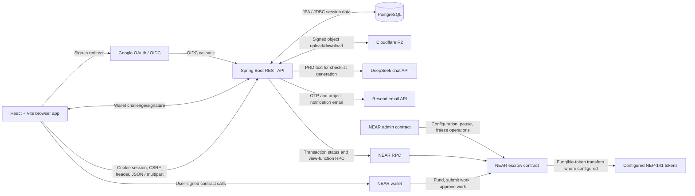
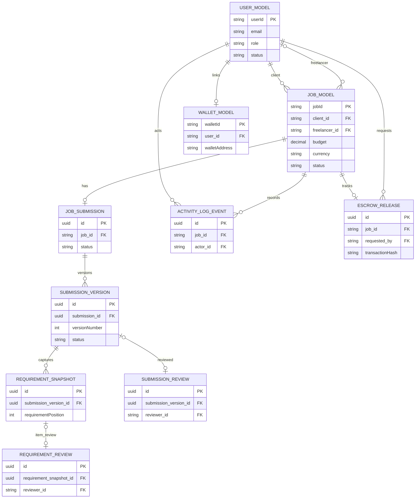

# PayProof Platform

PayProof is a project and payment workflow for clients and freelancers. It brings project briefs, requirements, agreements, work submissions, and escrow funding together in a web application backed by a Spring Boot API and NEAR smart contracts.

The codebase contains a React application, a separate React marketing site, a Java API, and a Rust Cargo workspace. They are four separate projects: there is no root-level command that builds or starts all four.

> **Implementation note:** This README distinguishes implemented behavior from partial integrations and known gaps. In particular, AI currently extracts a checklist from a project brief; it does not assess submitted work or make payment decisions.

## Contents

- [Product overview](#product-overview)
- [End-to-end user journey](#end-to-end-user-journey)
- [Core features and implementation status](#core-features-and-implementation-status)
- [Technology stack](#technology-stack)
- [Architecture and trust boundaries](#architecture-and-trust-boundaries)
- [Repository structure](#repository-structure)
- [Prerequisites](#prerequisites)
- [Configuration](#configuration)
- [Local development](#local-development)
- [REST API](#rest-api)
- [NEAR smart contracts](#near-smart-contracts)
- [AI checklist generation](#ai-checklist-generation)
- [Database and data model](#database-and-data-model)
- [Testing and validation](#testing-and-validation)
- [Deployment](#deployment)
- [Security considerations](#security-considerations)
- [Known limitations](#known-limitations)
- [Contributing](#contributing)
- [License](#license)

## Product overview

PayProof is intended for two primary account roles:

- **Clients** create projects, set the scope and financial terms, invite a freelancer, upload an agreement, review work, and initiate escrow funding and release.
- **Freelancers** receive invitations, accept projects, upload the agreement, submit deliverables, and receive escrow payouts after the client's approval.

The implemented workflow is:

1. A user registers with an email and password, signs in with an emailed one-time code, or begins Google OAuth with a selected account role.
2. A client creates a project with a title, description, budget, currency, deadline, and invited participant email.
3. The client can upload a PDF project requirements document (PRD). The backend extracts its text and asks DeepSeek to return a checklist. The client may approve the checklist; approval moves the project into freelancer acceptance.
4. The invited freelancer accepts or declines. After acceptance, the freelancer uploads an agreement PDF. Both participants approve the current agreement version; the client may request changes.
5. Before both participants approve the agreement, the client can update the budget and currency. Changing financial terms invalidates existing agreement approvals.
6. Once the agreement is approved and NEAR wallets are linked, the client can request escrow transaction parameters and sign the funding transaction with a NEAR wallet. For NEAR, the client funds the project amount plus a 3.5% platform fee; the freelancer receives the full project amount on release.
7. The freelancer submits work in the web application as a file or external URL, with optional notes. The backend stores submission versions and snapshots the approved checklist. The frontend also exposes a separate on-chain `submit_work` action with an evidence string.
8. The client reviews the submission and its checklist items. Approval requires a successful on-chain release transaction hash, verified by the backend against NEAR. Requested changes allow a subsequent submission version.
9. The application records activity and sends email notifications for selected submission/review/payout events.

The escrow contract supports participant disputes and client refund requests. The app now exposes case-submission flows and stores verified requests for later investigation, but it does not provide an admin dashboard or resolver interface. Raising a dispute or requesting a refund moves escrow to `Disputed`; it does not move funds. Only the configured on-chain dispute resolver can decide whether funds are released or refunded. A successful on-chain transaction and backend record update are distinct steps; users must not interpret a frontend status label alone as proof of final chain settlement.

## End-to-end user journey

This section follows a client and freelancer from account enrollment through project completion. It documents the current application flow, including the points where each participant must link a NEAR wallet. Wallet linking is separate from PayProof sign-in: users enroll and authenticate with PayProof first, then connect a NEAR wallet to their PayProof account for project actions that need it.

### 1. Enroll in PayProof and choose a role

The registration screen offers two account roles:

- **Client** — creates projects, invites freelancers, funds escrow, and reviews submitted work.
- **Freelancer** — receives invitations, participates in agreements, submits work, and receives payment after client approval.

A user can register with their name, email, password, and selected role, or start Google sign-up with a selected role. The registration UI requires a password of at least 12 characters containing a number and a symbol. Registration is not wallet sign-up; the wallet option on the registration and login screens is not currently available.

Email/password sign-in proceeds through a six-digit one-time code sent to the user's email. Google sign-in uses the selected role from the registration screen. On the login screen, Google sign-in currently starts with the `CLIENT` role because that screen has no role selector. After successful authentication, PayProof opens the role-specific workspace.

**Enrollment caveat:** the registration screen attempts to sign the user in immediately after creating the account, but it does not display the OTP-entry step if that sign-in attempt requires a code. A new email/password user may need to go to the login screen and complete OTP verification explicitly. Do not assume registration always leads directly into an authenticated workspace until this UI path is verified or corrected.

### 2. Link a NEAR wallet to the PayProof account

The user signs into PayProof first, then chooses **Connect wallet** in the application header. The app opens the configured NEAR wallet selector; the user selects or signs into a NEAR account. PayProof requests a short-lived challenge and the wallet signs it. The backend verifies the signature and the account/key association on the selected network before linking the wallet to the authenticated PayProof account.

The wallet address shown as connected in the PayProof workspace is the backend-verified linked wallet. Connecting a wallet is not the same as signing into PayProof, and it does not itself create a project or move funds. When a project action requires a wallet signature, the browser wallet session must be the same NEAR account as the wallet linked to that user's PayProof account.

For the current workflow:

- **The client must connect and link a NEAR wallet before creating a project/invitation.** The create-project form checks that a linked wallet exists and that the active NEAR account matches it.
- **The invited freelancer must connect and link a NEAR wallet before accepting the invitation.** The accept action checks the linked wallet and matching active NEAR account.
- The client uses its linked wallet to fund the escrow and approve a payout. The freelancer uses its linked wallet for the on-chain work-submission action.
- Client and freelancer wallets must be distinct for escrow funding. They must be linked to the correct PayProof accounts and configured for the same NEAR network as the application and contract.

The wallet selector currently uses Meteor Wallet. Network and escrow contract configuration come from the frontend environment, with testnet defaults in the checked-in source. A wallet connection on the wrong network/account is not sufficient; the user must switch to the expected account/network and retry.

### 3. Client creates a project and prepares the invitation

Only a `CLIENT` account can create a project. With the wallet linked, the client opens **Projects → New project** and supplies:

1. Project name and description.
2. Positive budget and currency.
3. Target delivery date.
4. Freelancer's email address.
5. A PDF project requirements document (PRD), which is required by the current form.

The frontend checks the wallet before sending the create request. The backend creates an open project addressed to the participant email. The client then uploads the PRD; the backend stores the PDF, extracts its readable text, and asks DeepSeek to propose an acceptance checklist. The client reviews and can edit the checklist, then approves it. Checklist approval advances the job to pending freelancer acceptance.

An AI-generated checklist is a draft aid, not a decision-maker. The client is responsible for making sure the approved requirements accurately describe the work. The current backend expects an extractable-text PDF and has upload limits; scanned PDFs without readable text may fail.

The project is not ready for the freelancer to accept until the checklist has been approved. The freelancer sees eligible invitations in the **Projects** area of their freelancer workspace. The backend associates the invitation with an email; do not assume an outbound invitation email is delivered unless that notification is separately configured and verified.

### 4. Freelancer reviews and accepts or declines

The freelancer signs into a `FREELANCER` account and opens the invitation to review the project brief, PRD, requirements checklist, amount, and deadline. To accept, the freelancer must first connect and link their NEAR wallet and ensure the active NEAR account matches the linked account. Acceptance records the freelancer on the job and advances it to the agreement stage.

Accepting an invitation is not signing the agreement, funding the project, or permission to begin work. The freelancer can decline instead; declining records the decision, and no agreement or payment is made through that action.

### 5. Freelancer uploads the agreement; both parties approve it

After acceptance, the freelancer uploads the agreement as a PDF. PayProof stores it as a version for the project and presents it for review. The current workflow is:

1. The client reads the uploaded agreement and checks that its terms reflect the project scope and financial terms.
2. The client can request changes with an explanation. The freelancer can upload a revised agreement version.
3. The client approves the current version first.
4. The freelancer reviews and approves that same current version.
5. The backend marks the agreement approved only when both approvals refer to the current version.

The agreement is a participant-provided PDF. The application does not currently draft a contract or automatically compare its text with the PRD. Before both approvals, the client can update the budget and currency; doing so clears approvals, and if an agreement already exists the freelancer must upload an updated agreement for review.

### 6. Client prepares and funds the escrow

Funding becomes available after the freelancer is assigned and both participants have approved the same agreement version. Both participants need distinct linked NEAR wallets on the configured network. The client opens the project's escrow page and:

1. Requests a funding preparation from the backend. The backend validates the job and wallets, reserves an escrow ID, and returns the NEAR contract call details.
2. Reviews the prepared amount, fee, network, and contract details in the application.
3. Approves/signs the transaction in the NEAR wallet.
4. Waits while PayProof checks the transaction through NEAR and reconciles the result with the backend project record.

The current backend escrow-preparation flow supports **NEAR only**, even though the UI and contract source mention other currencies. The code calculates a 3.5% client platform fee in addition to the agreed project amount; the freelancer's intended payout is the full project amount. The wallet may also show a NEAR network fee.

Funding is not confirmed just because the wallet prompt was approved or a transaction was submitted. Wait for PayProof's verification/status to confirm funding. If a transaction is pending or the status is uncertain, check the existing transaction rather than starting another payment.

### 7. Freelancer submits work against the funded project

The freelancer can submit only after the backend records the agreement as approved, the escrow as confirmed, and the project's approved checklist as available. The freelancer opens the delivery page and provides a file or external delivery URL, with optional notes. The current frontend limits an uploaded delivery file to 25 MB; the backend applies its own upload limits and validation.

The freelancer must have the linked NEAR wallet available and the active wallet account must match it. The frontend first sends an on-chain `submit_work` call with a short evidence string derived from the delivery link, notes, or file name, then sends the file/link/notes to the backend for storage as a versioned submission. The backend captures a snapshot of the approved requirements for that version.

These are separate operations across NEAR and the application API. If the on-chain call succeeds but saving the submission to the backend fails, the page reports that mismatch and supports retrying with the existing transaction; the user should not create a duplicate payment or assume the whole submission is complete until the application record is saved.

### 8. Client reviews the delivery, requests changes, or approves

The client opens the submitted version and reviews its file/link/notes against the captured requirements. The client can save item-by-item checklist review progress. If work needs changes, the client must provide feedback and request changes; the freelancer can then submit another version. Funds remain in escrow while the delivery is awaiting review or changes.

To approve the delivery, the client must:

1. Review and mark every submitted requirement as accepted.
2. Use the linked client NEAR wallet (with the matching active account) to sign the escrow contract's `approve_work` transaction.
3. Allow the backend to verify the successful NEAR release transaction and save the accepted review.

The backend rejects final acceptance unless all captured requirements have been accepted and the release transaction is verified. AI does not review the work or make this decision; the client does.

### 9. Finish the job and view the receipt

After successful release verification and acceptance, the backend marks the submission accepted and the job completed. PayProof records the delivery approval and payout activity, and sends selected email notifications when the notification service is configured. The project list provides a receipt route for completed work, showing the project and available agreement, submission, activity, and transaction details.

The receipt page may reconcile the release status with NEAR before displaying the completed project. Application records and blockchain state are separate: if either is temporarily unavailable or out of sync, retry status/reconciliation and verify the transaction rather than relying only on a visual label.

### If work is late or either party needs to raise a dispute

The project page offers **Raise a dispute** to either project participant while the project has confirmed escrow and is not completed. The client also sees **Request a refund** after the project deadline. The client must give a reason of 1–500 characters and sign the matching contract call with the linked NEAR wallet.

The contract enforces the participant role, active escrow status (`Funded` or `WorkSubmitted`), pause/freeze conditions, and one-yocto deposit. The backend additionally restricts refund requests to the client after the recorded deadline, verifies the final NEAR transaction and disputed escrow state, then saves the requester, reason, transaction hash, and timestamp in `escrow_dispute_cases` and records an activity event. The case record can be reviewed from the project page by its participants. A failed API save after the on-chain call can be retried using the saved transaction instead of signing a second dispute call.

`raise_dispute` is available to either client or freelancer. `request_refund` is client-only and represents a refund request, not an actual refund. Neither operation transfers funds. The project is marked `DISPUTED`, and only the account configured as the contract's `dispute_resolver` can call `resolve_dispute` to choose release to the freelancer or refund to the client. The app currently has no resolver/admin dashboard or resolution API; the recorded case is retained for later investigation. The contract can also freeze an escrow through its admin contract, but that control is not exposed as a user-facing dashboard flow.

### Flow summary

```text
Enroll as CLIENT or FREELANCER
        |
Sign in to PayProof
        |
Connect NEAR wallet and link it to the PayProof account
        |
CLIENT: create project -> upload PRD -> review/approve checklist
        |
FREELANCER: review invitation -> connect/link wallet -> accept
        |
FREELANCER: upload agreement -> CLIENT approves -> FREELANCER approves same version
        |
CLIENT: prepare and sign NEAR escrow funding -> backend verifies funding
        |
FREELANCER: submit on-chain evidence and application delivery
        |
CLIENT: review each requirement -> request changes OR approve and sign release
        |
Backend verifies release -> project marked complete -> receipt/activity
```

If work is overdue, the client can instead request a refund; either participant can raise a dispute while escrow remains active. Those actions record the case and move the on-chain escrow to `Disputed`; only the configured resolver decides the funds' outcome.

### Role/action checklist

| Action | Client | Freelancer | Wallet requirement |
|---|---|---|---|
| Enroll and sign in | Choose `CLIENT` | Choose `FREELANCER` | No wallet needed to enroll or sign in |
| Link wallet | Link own NEAR wallet | Link own NEAR wallet | Required for project creation/acceptance and chain actions |
| Create project and invite | Yes | No | Client's linked wallet must be connected before creating |
| Upload PRD and approve checklist | Yes | No | Client wallet check is performed when creating/sending the project |
| Accept or decline invitation | No | Yes | Freelancer must have a linked and matching wallet to accept; decline does not require the wallet |
| Upload agreement | No | Yes | No wallet transaction required for PDF upload |
| Approve agreement | Yes, first | Yes, after client | Application approval; no chain transaction required |
| Fund escrow | Yes | No | Client's linked wallet signs the NEAR funding transaction |
| Submit delivery | No | Yes | Freelancer's linked wallet signs the on-chain work-submission call |
| Review or request changes | Yes | No | Application review; requesting changes does not require a chain transaction |
| Approve delivery/release funds | Yes | No | Client's linked wallet signs the NEAR release transaction |

## Core features and implementation status

| Area | Status | What the source currently implements |
|---|---|---|
| Email/password authentication | Implemented | Registration, BCrypt password encoding, email OTP login, OTP resend limits, and HTTP-session authentication. |
| Google sign-in | Implemented in backend | OAuth2/OIDC login and role selection through `/api/auth/google`; frontend starts the OAuth redirect. Provider credentials and callback setup are required. |
| Project management | Implemented | Create/list/retrieve projects, invite by email, accept/decline invitations, update terms, and manage requirements checklist state. |
| PRD processing | Implemented, provider-dependent | PDF upload to R2, PDF text extraction, and DeepSeek checklist generation. This is not AI verification of submitted work. |
| Agreements | Implemented | Freelancer uploads a PDF agreement; client and freelancer approve the current version; client may request changes. |
| Work submissions | Implemented | File and/or external URL submissions with optional notes, versioning, checklist snapshots, review state, and R2 download URLs. |
| AI-powered verification | Not implemented | No code compares submitted evidence with requirements, produces confidence scores, or authorizes payment using an AI decision. |
| NEAR wallet linking | Implemented for NEAR | A five-minute challenge is signed with NEP-413; the backend verifies the signature and checks that the public key belongs to the account on the selected network. |
| Escrow preparation/funding | Partial | Backend reservation and transaction verification currently support NEAR only. Contract source also supports configured USDT/USDC FT flows, but those are not enabled by the backend escrow preparation service. |
| Escrow payout | Implemented across on-chain and API steps | Client submits `approve_work` directly on NEAR; the backend verifies the release transaction and updates the database when the submission review is accepted. |
| Dispute/refund requests | Request flow implemented; resolution tooling incomplete | Either participant can raise a dispute; only the overdue project's client can request a refund in the UI. The backend verifies the NEAR transaction and stores an investigation case and activity event. The resolver/admin dashboard and resolution endpoint are not implemented. |
| Activity and email notifications | Implemented for selected events | Project activities are persisted and listed. Resend emails are emitted for submission, requested changes, and payout notifications, as well as OTP sign-in. |
| Payment receipt | Partial | A receipt page/route exists in the frontend. A dedicated receipt API endpoint is not defined by the current controllers. |
| Public marketing site | Implemented separately | `payproof-landing-page/` is a standalone React/Vite site. Its sign-up and login links point to the hosted application; the landing site does not call the backend. |
| Google/NEAR sign-in alternatives | Partial | The backend implements Google OAuth and wallet linking; the frontend wallet sign-in button currently reports that wallet sign-in is unavailable. Wallet linking is separate from authentication. |

## Technology stack

| Layer | Technology found in the repository |
|---|---|
| Frontend | React `19.3.1`, JavaScript modules, React Router `7.18.5`, Vite `8.3.5`, Lucide React |
| Public marketing site | Separate React `19.3.1` and Vite `8.3.6` app in `payproof-landing-page/` |
| NEAR frontend | NEAR Wallet Selector `10.1.4` packages, `near-api-js` `6.5.1`, Meteor Wallet module |
| Backend | Java, Spring Boot `4.2.0-SNAPSHOT`, Spring MVC, Spring Security, Spring Data JPA, Maven |
| Database | PostgreSQL, Hibernate/JPA; JDBC-backed Spring Session |
| Blockchain | NEAR; backend RPC defaults to the testnet endpoint, and the frontend defaults to the `testnet` network |
| Smart contracts | Rust `1.93.0`, NEAR SDK `5.29` for admin and escrow; USDT test stub uses NEAR SDK `5.14` |
| AI provider | Spring AI DeepSeek chat model (`deepseek-chat`) |
| File storage | Cloudflare R2 accessed using S3-compatible signed HTTP requests |
| Authentication | Spring Security, cookie-backed HTTP sessions, BCrypt passwords, Google OAuth2/OIDC |
| Email | Resend HTTP API for OTP and selected project notifications |
| Build and checks | Maven Wrapper, npm scripts, Cargo; Oxlint for frontend linting |

### Frontend routes

The route table in [`App.jsx`](payproof-frontend/src/App.jsx) defines these screens:

| Route | Screen |
|---|---|
| `/login`, `/register` | Email/OTP sign-in and account creation |
| `/overview`, `/activity` | Workspace overview and project activity |
| `/projects`, `/projects/new`, `/projects/:jobId` | Project list, creation, and details |
| `/projects/:jobId/submission`, `/projects/:jobId/submissions/:versionId` | Work submission and submission-version review |
| `/projects/:jobId/receipt` | Payment receipt view |
| `/agreements`, `/agreements/:jobId` | Agreement list and agreement review |
| `/escrow`, `/escrow/:jobId` | Escrow list and funding flow |

Protected screens are wrapped in `ProtectedRoute` and the shared `AppLayout`. The route guard checks session state; project-level permissions remain enforced by the API and contracts.

## Architecture and trust boundaries



### Responsibilities and enforcement

- **React frontend:** presents project pages, gathers user input, invokes API services, and requests wallet signatures. Frontend navigation and status displays are not authorization controls.
- **Spring Boot API:** authenticates browser sessions, validates project participants and roles, stores application records, signs R2 requests, calls DeepSeek for PRD checklist generation, and verifies submitted NEAR transaction details/status.
- **PostgreSQL:** stores JPA entities and Spring Session JDBC state. It is the application's source for project metadata and review records; it is not the NEAR ledger.
- **NEAR escrow contract:** enforces on-chain escrow state transitions and asset transfers for supported assets. It verifies caller identity against the client/freelancer/dispute-resolver accounts stored in contract state.
- **NEAR admin contract:** administers fee and contract configuration, pause state, escrow freeze controls, and configuration synchronization.
- **DeepSeek:** returns a proposed checklist from extracted PRD text. Its output is parsed and bounded by the backend, but it does not authorize or execute payments.
- **Cloudflare R2:** holds uploaded PDFs and submission files. The API generates signed object requests and time-limited download URLs.
- **External integrations:** Google authenticates OIDC users, Resend sends emails, and NEAR RPC provides chain transaction/view information.

The browser interacts directly with NEAR for wallet-signed funding, work-submission, and approval calls. The backend separately checks chain transactions before accepting relevant database transitions. Database state, an RPC response, a wallet-reported transaction, and a smart-contract state are related but are not interchangeable trust domains.

## Repository structure

```text
payproof-platform/
├── README.md
├── payproof-landing-page/       # Standalone public React/Vite marketing site
│   ├── package.json
│   ├── index.html
│   ├── public/
│   └── src/
├── payproof/
│   ├── Dockerfile
│   ├── .mvn/
│   ├── mvnw
│   ├── mvnw.cmd
│   ├── pom.xml
│   └── src/
│       ├── main/java/com/example/payproof/
│       │   ├── config/          # Spring Security, auth, password, Jackson setup
│       │   ├── controller/      # REST controller mappings
│       │   ├── dto/             # Request/response types and checklist item
│       │   ├── enums/
│       │   ├── exceptions/
│       │   ├── model/           # JPA entities
│       │   ├── repository/
│       │   ├── security/
│       │   └── service/         # Auth, projects, R2, AI, email, wallet, escrow
│       ├── main/resources/
│       │   ├── application.properties
│       │   └── templates/login-otp.html
│       └── test/java/           # Spring context smoke test
├── payproof-frontend/
│   ├── package.json
│   ├── package-lock.json
│   ├── vite.config.js
│   ├── public/
│   └── src/
│       ├── components/
│       ├── context/
│       ├── css/
│       ├── pages/
│       └── services/            # API, auth, jobs, submissions, wallets, escrow
└── near_hackathon/
    ├── Cargo.toml               # Rust workspace
    ├── Cargo.lock
    ├── rust-toolchain.toml
    ├── .github/workflows/       # Contract tests and staging/production workflows
    ├── contracts/
    │   ├── admin/
    │   ├── escrow/
    │   └── usdt-stub/
    ├── src/
    └── tests/
```

The repository root has no `.gitmodules` file; `near_hackathon/` is a directory in this repository, not a Git submodule. No root-level `.gitignore`, Docker Compose file, or root build script was found; ignore rules are inside the backend and frontend projects.

### Source references

| Concern | Source |
|---|---|
| Backend dependencies and Java level | [`payproof/pom.xml`](payproof/pom.xml) |
| Backend properties | [`application.properties`](payproof/src/main/resources/application.properties) |
| Security, CORS, CSRF, session authentication | [`SecurityConfig.java`](payproof/src/main/java/com/example/payproof/config/SecurityConfig.java), [`AuthenticationConfig.java`](payproof/src/main/java/com/example/payproof/config/AuthenticationConfig.java) |
| Authentication and OTP routes/logic | [`AuthController.java`](payproof/src/main/java/com/example/payproof/controller/AuthController.java), [`LoginOtpService.java`](payproof/src/main/java/com/example/payproof/service/LoginOtpService.java) |
| Project routes and lifecycle | [`JobController.java`](payproof/src/main/java/com/example/payproof/controller/JobController.java), [`JobService.java`](payproof/src/main/java/com/example/payproof/service/JobService.java) |
| Submission routes and review | [`SubmissionController.java`](payproof/src/main/java/com/example/payproof/controller/SubmissionController.java), [`SubmissionService.java`](payproof/src/main/java/com/example/payproof/service/SubmissionService.java) |
| Escrow preparation and transaction checks | [`EscrowController.java`](payproof/src/main/java/com/example/payproof/controller/EscrowController.java), [`EscrowCreationService.java`](payproof/src/main/java/com/example/payproof/service/EscrowCreationService.java), [`NearTransactionVerifier.java`](payproof/src/main/java/com/example/payproof/service/NearTransactionVerifier.java) |
| AI and object storage | [`DeepSeekService.java`](payproof/src/main/java/com/example/payproof/service/DeepSeekService.java), [`R2StorageService.java`](payproof/src/main/java/com/example/payproof/service/R2StorageService.java) |
| Wallet challenge and verification | [`WalletAuthService.java`](payproof/src/main/java/com/example/payproof/service/WalletAuthService.java), [`NearSignatureVerifier.java`](payproof/src/main/java/com/example/payproof/service/NearSignatureVerifier.java) |
| Frontend routes, API and NEAR configuration | [`App.jsx`](payproof-frontend/src/App.jsx), [`api.js`](payproof-frontend/src/services/api.js), [`escrowService.js`](payproof-frontend/src/services/escrowService.js), [`vite.config.js`](payproof-frontend/vite.config.js) |
| Public landing site | [`App.jsx`](payproof-landing-page/src/App.jsx), [`index.html`](payproof-landing-page/index.html), [`package.json`](payproof-landing-page/package.json) |
| Contract workspace and pinned Rust toolchain | [`near_hackathon/Cargo.toml`](near_hackathon/Cargo.toml), [`rust-toolchain.toml`](near_hackathon/rust-toolchain.toml) |
| Contract implementations and tests | [`escrow contract`](near_hackathon/contracts/escrow/src/lib.rs), [`admin contract`](near_hackathon/contracts/admin/src/lib.rs), [`test token`](near_hackathon/contracts/usdt-stub/src/lib.rs), [`escrow tests`](near_hackathon/contracts/escrow/tests/escrow_tests.rs), [`escrow fee tests`](near_hackathon/contracts/escrow/tests/escrow_fee_tests.rs), [`admin tests`](near_hackathon/contracts/admin/tests/admin_tests.rs) |

## Prerequisites

### Required for each project

| Component | Requirement verified from configuration |
|---|---|
| Backend | Java `27` is declared in `payproof/pom.xml`. Use the included Maven Wrapper (`mvnw` / `mvnw.cmd`); a separate Maven install is not required. |
| Frontends | Node.js `^20.19.0` or `>=22.12.0` and npm are required by the Vite `8.3.5`/`8.3.6` engine metadata in the two frontend lockfiles. Neither package pins an npm version. |
| Rust contracts | `rust-toolchain.toml` pins Rust `1.93.0`, with `rustfmt`, `clippy`, and the `wasm32-unknown-unknown` target. Cargo is installed with the Rust toolchain. |
| API data/session storage | PostgreSQL is required by the configured datasource and JDBC session store. |
| NEAR contract build/deploy | `cargo-near` is used by the checked-in contract CI workflows. `near-cli-rs` is used for the staging-account cleanup/deployment workflow. |

### Optional external services

Google OAuth, Resend, Cloudflare R2, DeepSeek, a NEAR wallet, and NEAR RPC are integration dependencies. They are required for their corresponding live features; the backend's checked-in configuration includes several non-optional property placeholders, so configure those values even if you are not exercising every feature. There is no checked-in `.env.example`.

The backend Dockerfile uses a Java 21 build/runtime image while Maven declares Java 27. That mismatch is present in the repository; align the Dockerfile and Maven Java version before relying on the image.

## Configuration

### 1. Backend

The backend imports an optional `.env` file from its current working directory through `spring.config.import=optional:file:.env[.properties]`. Create `payproof/.env` locally. Do not copy real credentials into this README or commit them.

The following variables are referenced by `application.properties`:

| Variable | Required? | Purpose and format |
|---|---:|---|
| `PORT` | Optional | HTTP port; default `8080`. |
| `DATABASE_URL` | Required | PostgreSQL JDBC URL, for example `jdbc:postgresql://localhost:5432/payproof`. |
| `DATABASE_USER` | Required | PostgreSQL username. |
| `DATABASE_PASSWORD` | Required | PostgreSQL password. |
| `GOOGLE_CLIENT_ID` | Required for configured startup | OAuth2 client ID from Google Cloud; provider configuration has no placeholder default. |
| `GOOGLE_CLIENT_SECRET` | Required for configured startup | OAuth2 client secret. |
| `R2_ACCOUNT_ID` | Required | Cloudflare R2 account identifier. |
| `R2_ACCESS_KEY` | Required | R2 S3-compatible access key. |
| `R2_SECRET_KEY` | Required | R2 S3-compatible secret key. |
| `R2_BUCKET` | Required | R2 bucket name. |
| `DEEPSEEK_API_KEY` | Required for configured startup | DeepSeek API key. Model and temperature are properties in `application.properties`. |
| `RESEND_API_KEY` | Optional at configuration binding; required to send email | Resend bearer API key. If absent, email sending fails and OTP delivery cannot complete. |
| `RESEND_FROM` | Optional | Sender string; the properties file supplies a default. Configure a sender/domain allowed by Resend. |
| `PAYPROOF_APP_URL` | Optional | Base URL used in notification links; the properties file supplies a default. |
| `PAYPROOF_FRONTEND_URL` | Optional | Destination after Google OAuth succeeds; defaults to `https://app.payproof.site`. Set to `http://localhost:5173` for local development. |
| `NEAR_USDT_CONTRACT_ID` | Optional | Overrides the testnet USDT-contract default. This is a contract account ID, not a secret. |

Example with placeholders only:

```dotenv
PORT=8080
DATABASE_URL=jdbc:postgresql://localhost:5432/payproof
DATABASE_USER=postgres
DATABASE_PASSWORD=replace-with-local-password

GOOGLE_CLIENT_ID=replace-with-google-client-id
GOOGLE_CLIENT_SECRET=replace-with-google-client-secret

R2_ACCOUNT_ID=replace-with-r2-account-id
R2_ACCESS_KEY=replace-with-r2-access-key
R2_SECRET_KEY=replace-with-r2-secret-key
R2_BUCKET=replace-with-r2-bucket-name

DEEPSEEK_API_KEY=replace-with-deepseek-api-key
RESEND_API_KEY=replace-with-resend-api-key
RESEND_FROM=PayProof <no-reply@example.com>
PAYPROOF_APP_URL=http://localhost:5173/
PAYPROOF_FRONTEND_URL=http://localhost:5173

# Optional testnet contract override:
NEAR_USDT_CONTRACT_ID=replace-with-testnet-token-account
```

Additional backend properties in `application.properties` include the session timeout, cookie flags, Google scopes, upload size limits, NEAR network/RPC and contract IDs, USDC contract/decimals, and DeepSeek model settings. Apart from the USDT override above, the checked-in file does not express these NEAR settings as dedicated `${ENV_VAR}` placeholders. Review and override Spring properties deliberately when deploying to another environment.

### 2. Frontend

Vite exposes these optional variables to the client:

| Variable | Default/behavior | Purpose |
|---|---|---|
| `VITE_BACKEND_ORIGIN` | Empty string (same-origin requests) | API origin used by `src/services/api.js`. |
| `VITE_NEAR_NETWORK` | `testnet` | NEAR network used by wallet and transaction modules. |
| `VITE_ESCROW_CONTRACT_ID` | Wallet selector has a source-code fallback; some escrow transaction code expects this explicitly | Contract account selected by the wallet UI. Set it consistently with backend configuration and the selected network. |

Example `payproof-frontend/.env.local`:

```dotenv
VITE_BACKEND_ORIGIN=http://localhost:8080
VITE_NEAR_NETWORK=testnet
VITE_ESCROW_CONTRACT_ID=replace-with-your-testnet-escrow-contract
```

With `VITE_BACKEND_ORIGIN` unset, API requests default to `http://localhost:8080`; set it to the hosted API origin when using the live backend. Restart Vite after changing environment variables. Do not put secret keys in `VITE_*` variables: they are bundled into browser code. Add the backend callback URL to the Google Cloud OAuth client's authorized redirect URIs: `http://localhost:8080/login/oauth2/code/google` locally and the corresponding HTTPS backend URL in production.

### 3. Public landing page

The marketing site has no backend or Vite environment variables. Its login and sign-up links are set to `https://app.payproof.site` in `payproof-landing-page/src/App.jsx`; change that constant when testing against a different application origin.

### 4. Rust contracts

The contracts do not read a project `.env` file. Their initial configuration is supplied as initialization arguments, and the admin contract stores its treasury, resolver, token contract IDs, and fee in contract state. Build/deployment network and account configuration is provided to `cargo near`/NEAR CLI commands or GitHub Actions variables and secrets.

The checked-in Rust workflows reference these GitHub Actions settings:

- Variables: `NEAR_CONTRACT_STAGING_ACCOUNT_ID`, `NEAR_CONTRACT_STAGING_ACCOUNT_PUBLIC_KEY`, `NEAR_CONTRACT_STAGING_NETWORK`, `NEAR_CONTRACT_PRODUCTION_ACCOUNT_ID`, and `NEAR_CONTRACT_PRODUCTION_NETWORK`.
- Secrets: `NEAR_CONTRACT_STAGING_ACCOUNT_PRIVATE_KEY` and `NEAR_CONTRACT_PRODUCTION_ACCOUNT_PRIVATE_KEY`.

These are workflow configuration names, not values. Use repository/environment secrets; never commit private keys.

## Local development

### 1. Clone the repository

```powershell
git clone https://github.com/0xdavid01/Payproof-Global.git
Set-Location Payproof-Global
```

There are no submodules to initialize.

### 2. Configure PostgreSQL and the backend

Create a local PostgreSQL database and user, then create `payproof/.env` with the backend values described above. For OTP email, provide valid Resend credentials and sender configuration. Google, R2, and DeepSeek credentials are needed to exercise their corresponding features; the backend configuration also references these properties at startup.

### 3. Run the backend

Windows PowerShell:

```powershell
Set-Location payproof
.\mvnw.cmd spring-boot:run
```

macOS/Linux:

```bash
cd payproof
./mvnw spring-boot:run
```

By default the API listens on port `8080`. The datasource URL and credentials must refer to a reachable PostgreSQL instance. Set `PAYPROOF_FRONTEND_URL=http://localhost:5173` in `payproof/.env` so successful Google sign-in returns to the local app; the default destination is the deployed app at `https://app.payproof.site`.

### 4. Install and run the frontend

Windows PowerShell:

```powershell
Set-Location payproof-frontend
npm ci
npm run dev
```

macOS/Linux:

```bash
cd payproof-frontend
npm ci
npm run dev
```

Open the local URL printed by Vite (the configured port is `5173`). Set `VITE_BACKEND_ORIGIN` to the local API if you do not want to use the configured hosted-backend proxy. The API currently marks session cookies `Secure` and `SameSite=None`; verify browser cookie behavior and origins in your local setup.

### 5. Install and run the public landing page

The marketing site is independent of the authenticated application and can be run without the API:

```powershell
Set-Location payproof-landing-page
npm ci
npm run dev
```

macOS/Linux:

```bash
cd payproof-landing-page
npm ci
npm run dev
```

The landing page's login and sign-up buttons still link to the hosted application unless `signupUrl` in `src/App.jsx` is changed.

### 6. Build and test the contracts

From `near_hackathon/`:

```powershell
cargo test --workspace
cargo build --workspace
```

macOS/Linux:

```bash
cargo test --workspace
cargo build --workspace
```

For a reproducible WebAssembly build, use the pinned toolchain and `cargo-near` from a contract crate directory, for example:

```powershell
rustup target add wasm32-unknown-unknown
cargo install cargo-near
Set-Location contracts\escrow
cargo near build
```

Repeat under `contracts\admin` for the admin contract. A build does not initialize or configure deployed contracts. Initialization calls, account IDs, network, and admin/escrow synchronization must be handled as a separate deployment operation.

## REST API

The routes below are based on Spring controller mappings. Unless marked public, API requests require an authenticated session. Role and project-participant checks are performed in service methods; a valid session alone does not grant access to every project.

### Session, authentication, and CSRF

| Method and route | Auth | Request | Response / behavior |
|---|---|---|---|
| `GET /api/csrf` | Public | None | JSON object with `token`; creates/saves a CSRF cookie if one is not present. |
| `POST /api/auth/register` | Public; CSRF-exempt | JSON `UserRegistrationRequest` | `201` with `UserResponse`. First/last name max 100; email valid; password at least 8 characters; role required. |
| `POST /api/auth/login` | Public; CSRF-exempt | JSON `{ "email": "...", "password": "..." }` | Authenticates password and starts OTP challenge; returns `requiresOtp` and canonical email, not an authenticated app session yet. |
| `POST /api/auth/verify-otp` | Public route, pending challenge required | JSON `{ "email": "...", "code": "123456" }` | Establishes an HTTP session and returns a success message and email. Code must be six digits. |
| `POST /api/auth/resend-otp` | Public route, pending challenge required | JSON `{ "email": "..." }` | Returns a generic delivery message. A resend is rate-limited; invalid/non-pending challenges return without revealing account state. |
| `GET /api/auth/me` | Authenticated | None | `UserResponse` for the current principal. |
| `POST /api/auth/logout` | Public mapping; clears current session when present | No body | JSON success message. A CSRF token is required by the configured CSRF filter for this state-changing request. |
| `GET /api/auth/google?role=CLIENT` | Public | `role` query parameter (`CLIENT` or `FREELANCER`) | JSON `authorizationUrl` for starting Spring's Google OAuth flow; other roles return `400`. |
| `GET /api/whoami` | Authenticated | None | Diagnostic endpoint; see `DiagnosticController` for its current response. |

Example registration request:

```json
{
  "firstName": "Alex",
  "lastName": "Example",
  "email": "alex@example.com",
  "password": "replace-with-a-long-password",
  "role": "CLIENT"
}
```

The user response fields are `userId`, `firstName`, `lastName`, `displayName`, `email`, `profilePictureUrl`, `role`, `status`, and `createdAt`.

### Wallet management

All wallet management routes require an authenticated user session. Linking a wallet does not sign the user into PayProof.

| Method and route | Request | Response / checks |
|---|---|---|
| `GET /api/auth/wallet` | None | Connected wallet response, or `204 No Content` if no connected wallet exists. |
| `POST /api/auth/wallet/challenge` | JSON `WalletChallengeRequest`: `walletAddress`, `blockchain`, `network` | `WalletChallengeResponse` includes `message`, `nonce`, `recipient`, and `expiresAt`; NEAR only, expires after five minutes. |
| `POST /api/auth/wallet/verify` | JSON `WalletVerificationRequest`: `accountId`, `publicKey`, `signature`, `nonce`, `blockchain`, `network` | Verifies challenge ownership, unused/unexpired nonce, NEP-413 signature, and public-key access on the selected NEAR network; then links the wallet. |
| `POST /api/auth/wallet/revoke` | No body | Revokes the signed-in user's connected wallet. |

The network enum accepts `TESTNET` or `MAINNET`. The signature verifier currently parses Ed25519 public keys and NEP-413 signatures.

### Projects, requirements, and agreements

| Method and route | Auth and authorization | Request | Response / behavior |
|---|---|---|---|
| `POST /api/jobs` | `CLIENT` role | JSON `CreateJobRequest` | Creates and returns a `JobModel`. Required fields include `title`, `description`, positive `budget`, `currency`, and `participantEmail`; service validation also requires a deadline. The `prdUrl` request property is present but creation initializes the stored PRD URL to null; use the PRD upload route. |
| `GET /api/jobs/client` | `CLIENT` role | None | Client's jobs (`List<JobModel>`). |
| `GET /api/jobs/freelancer` | `FREELANCER` role | None | Assigned/invited jobs, excluding declined/expired invitations. |
| `GET /api/jobs/{jobId}` | Client, assigned freelancer, or pending invitee | None | The accessible `JobModel`; otherwise `404`/`403`. |
| `POST /api/jobs/{jobId}/prd` | Owning client | `multipart/form-data`, required `file` PDF | Stores PDF, extracts text, generates requirements with DeepSeek, and returns updated `JobModel`. Empty/scanned-without-text/encrypted PDFs or provider/storage failures are rejected. |
| `PUT /api/jobs/{jobId}/checklist/approve` | Owning client | JSON `{ "requirements": [{ "isDone": false, "condition": "..." }] }` | Replaces requirements, marks checklist approved, advances job to freelancer acceptance, returns `JobModel`. Requirements cannot be empty and each condition must be nonblank. |
| `PUT /api/jobs/{jobId}/checklist/progress` | Owning client | JSON `{ "requirements": [...] }` using `JobRequirement` fields | Updates checklist completion after approval; returns `JobModel`. |
| `POST /api/jobs/{jobId}/invitation/accept` | Invited `FREELANCER` | No body | Assigns the freelancer and advances the project if the checklist has been approved. |
| `POST /api/jobs/{jobId}/invitation/decline` | Invited `FREELANCER` | No body | Marks the pending invitation declined. |
| `PUT /api/jobs/{jobId}/financial-terms` | Owning `CLIENT` | JSON `{ "budget": 100, "currency": "NEAR" }` | Updates positive budget/currency before both agreement approvals; invalidates prior approvals if an agreement exists. |
| `POST /api/jobs/{jobId}/contract` | Assigned `FREELANCER` | `multipart/form-data`, required `file` PDF | Uploads a new agreement version while the project is awaiting agreement; returns updated `JobModel`. |
| `POST /api/jobs/{jobId}/contract/request-changes` | Owning `CLIENT` | JSON `{ "reason": "..." }`; reason max 2,000 characters | Marks agreement changes requested and clears approvals. |
| `POST /api/jobs/{jobId}/contract/approve` | Either project participant | No body | Records the caller's approval of the current uploaded version; agreement becomes approved only after both client and freelancer approve the same version. |
| `GET /api/jobs/{jobId}/contract/download-url` | Project participant or pending invitee | None | `ContractDownloadUrlResponse` containing a time-limited signed R2 URL; `404` if no agreement exists. |

`PaymentCurrency` contains `NEAR`, `USDT`, and `USDC`; however, the current backend escrow-preparation implementation rejects non-NEAR currencies with `501 Not Implemented`.

### Submissions and reviews

| Method and route | Auth and authorization | Request | Response / behavior |
|---|---|---|---|
| `POST /api/jobs/{jobId}/submissions` | Assigned `FREELANCER` | `multipart/form-data`; `file` and `externalUrl` are optional individually, but at least one must be provided; `notes` optional | Creates the next submission version and returns a `SubmissionVersion`. Requires an approved contract, confirmed escrow, and approved checklist. A new version is accepted only when no review is pending or the prior status requests changes. |
| `GET /api/jobs/{jobId}/submissions` | Accessible project participant | None | List of `SubmissionVersionResponse` items with version status, file metadata/URL, external URL, notes, review details, release hash, and per-requirement review fields. |
| `POST /api/jobs/{jobId}/submissions/{versionId}/review` | Owning `CLIENT` | JSON `ReviewSubmissionRequest` | Saves itemized review progress or requests changes. `ACCEPTED` requires all requirement items accepted and a transaction hash that verifies as a successful on-chain `approve_work` release. Returns a `SubmissionReview`. |

Example review request shape (the status values are enum values):

```json
{
  "status": "ACCEPTED",
  "feedback": "Reviewed against the approved scope.",
  "transactionHash": "replace-with-the-final-near-transaction-hash",
  "requirements": [
    {
      "requirementPosition": 0,
      "status": "ACCEPTED",
      "feedback": "Verified by the client."
    }
  ]
}
```

Review request fields are `status`, optional `feedback` (max 10,000 characters), optional `transactionHash` (max 128 characters), and optional `requirements`. Each requirement review has `requirementPosition`, `status`, and optional `feedback`. A release approval requires the requirement list to cover and accept every saved requirement snapshot.

### Escrow

| Method and route | Auth and authorization | Request | Response / behavior |
|---|---|---|---|
| `POST /api/escrows` | Owning `CLIENT` | JSON `{ "jobId": "..." }` | Reserves escrow and returns `CreateEscrowResponse` transaction instructions. Requires an approved agreement, assigned freelancer, distinct connected NEAR wallets, positive NEAR amount, and no existing confirmed escrow. Currently NEAR only. |
| `POST /api/escrows/{escrowId}/confirm` | Owning `CLIENT` | `ConfirmEscrowRequest` JSON: `{ "jobId": "...", "transactionHash": "..." }` | Records the transaction, checks it via NEAR RPC against the reserved signer, contract, function-call arguments, and on-chain escrow state, then returns `escrowId`, `jobId`, `status`, and `isFunded`. |
| `POST /api/escrows/jobs/{jobId}/reconcile-release` | Project client or freelancer | No body | Checks whether the saved escrow is released on-chain and reconciles the latest saved submission as accepted; returns `{ "released": boolean }`. |
| `POST /api/escrows/jobs/{jobId}/disputes` | Project client or assigned freelancer | JSON `{ "reason": "...", "transactionHash": "..." }` | Records a dispute after verifying a successful `raise_dispute` call by the participant's linked wallet and the on-chain `Disputed` state. The contract itself accepts only `Funded` or `WorkSubmitted` escrows. |
| `POST /api/escrows/jobs/{jobId}/refund-requests` | Owning client | JSON `{ "reason": "...", "transactionHash": "..." }` | Requires the project deadline to have passed, then verifies a successful client `request_refund` call and records the case. This requests resolver review; it does not transfer funds. |
| `GET /api/escrows/jobs/{jobId}/dispute-case` | Project client or assigned freelancer | None | Returns the recorded case, or `204 No Content` if no case was recorded. |

Verified requests are persisted in the `escrow_dispute_cases` table and also appear in participant activity. There is currently no admin-facing query endpoint/dashboard or resolver endpoint; system-admin investigation is not yet available through the UI.

The backend controller has **no `GET /api/escrows/job/{jobId}` route**. The frontend currently calls that path from `getEscrowForJob`; this API/UI mismatch is documented under [Known limitations](#known-limitations).

`CreateEscrowResponse` contains `escrowId`, `jobId`, `network`, `contractId`, `tokenContractId`, `methodName`, `clientWalletAddress`, `freelancerWalletAddress`, `asset`, `amount`, `platformFee`, `attachedDeposit`, `gas`, `args`, `title`, `description`, and `message`. For NEAR, `amount` and `args.amount` are the project amount payable to the freelancer, `platformFee` is the 3.5% client fee, and `attachedDeposit` is their sum.

The frontend validates the preparation and derives the NEAR fee/deposit in yoctoNEAR before signing, so it does not rely on a stale or inconsistent saved deposit. The backend independently verifies the transaction value and fee against the job amount. Both currently use a fixed 350 basis points; keep that value synchronized with the deployed escrow contract configuration.

### Activity

| Method and route | Auth and authorization | Request | Response |
|---|---|---|---|
| `GET /api/activity` | Authenticated project participant | None | List of `ActivityLogResponse`: `id`, `jobId`, `projectTitle`, `action`, `summary`, `actorName`, `actorRole`, and `occurredAt`. |

### Session cookies, CSRF, and errors

- The backend uses `HttpSessionSecurityContextRepository`; sessions are stored through Spring Session JDBC and expire after 30 minutes as configured.
- The frontend uses `fetch` with `credentials: "include"`. It requests `/api/csrf` and sends `X-XSRF-TOKEN` for state-changing requests, except login and registration, which the API explicitly exempts.
- Wallet-signature verification errors are also returned as `401`; the frontend handles that endpoint without treating an invalid wallet signature as an expired PayProof session.
- The backend configures session cookies with `SameSite=None` and `Secure=true`, and allows credentials only for origins listed in `SecurityConfig`.
- Most unauthenticated API requests receive HTTP `401`; role/ownership failures are generally `403`, unavailable resources `404`, and invalid workflow transitions often `400` or `409`. Specific validations are described above; consult the controller/service for exact messages.
- This is a controller-derived overview, not an OpenAPI specification. Not every entity serialization detail or error response is fixed by a dedicated API schema.

## NEAR smart contracts

The Cargo workspace is pinned to Rust `1.93.0`. Contract code uses NEAR SDK. The checked-in CI workflows build/test the workspace and deploy WASM to configured staging/production account IDs, but deploy with `without-init-call`; initialization and contract synchronization are separate operational steps.

### Escrow contract (`contracts/escrow`)

**Initialization:** `new(admin_contract: AccountId)` is `#[init]`. A new escrow contract starts paused and unconfigured, with a default fee of 350 basis points. It must receive configuration from the admin contract before new funding is available.

**Assets:**

- `Asset::Near`, funded with an exact attached NEAR deposit through `create_and_fund_with_near`.
- `Asset::Usdt` and `Asset::Usdc`, accepted through `ft_on_transfer` only from configured token contract IDs using NEP-141 `ft_transfer_call`.

Support in the contract does not mean support in every product layer: backend reservation/funding currently permits NEAR only. The `usdt-stub` crate is a test token, not actual USDT.

**Lifecycle and important methods:**

| Method | Contract-level behavior |
|---|---|
| `create_and_fund_with_near` | Payable atomic NEAR escrow creation and funding. `amount` is the project amount; the attached deposit must equal `amount` plus the platform fee. Caller becomes client. |
| `ft_on_transfer` | Accepts a JSON create-and-fund message for configured USDT/USDC contracts; invalid/unconfigured/paused calls return the transferred amount. |
| `submit_work` | Freelancer-only while escrow is funded; stores an evidence string (up to 10,000 bytes/characters as checked by Rust `String::len`) and moves status to `WorkSubmitted`. |
| `approve_work` | Client-only after work submission; pays the freelancer the full project amount and accrues the client-paid platform fee. |
| `request_refund` | Client-only in `Funded` or `WorkSubmitted`; records a refund request as `Disputed` but does not itself transfer funds. |
| `raise_dispute` | Client or freelancer may raise a dispute in `Funded` or `WorkSubmitted`. |
| `resolve_dispute` | Configured dispute resolver decides whether to release to freelancer or refund client. |
| `retry_failed_settlement` | Allows permitted party/parties to retry a failed payout/refund according to settlement type. |
| `freeze_escrow`, `unfreeze_escrow` | Admin-contract-only controls with configuration/operation version checks. |
| `get_escrow`, `get_platform_configuration`, `get_accrued_fees`, `is_paused`, `is_configured` | Read-only contract views. |

Statuses in source are `AwaitingFunding` (retained for compatibility), `Funded`, `WorkSubmitted`, `Disputed`, `Releasing`, `Refunding`, `SettlementFailed`, `Released`, and `Refunded`. The current atomic creation paths persist newly funded escrows directly as `Funded`.

**Fees and settlement:** fee basis points default to `350` (3.5%) and are capped at `1,000` (10%). The client funds the project amount plus the fee. The freelancer receives the full project amount on release, and the fee is accrued for treasury withdrawal. A refund transfers the full funded amount back to the client. Transfers use asynchronous promises and private callbacks to update settlement status; failed callbacks record a failed settlement for retry.

Many state-changing methods require an attached one yoctoNEAR deposit; caller identity, state, pause status, configured-contract identity, and input bounds are checked in contract methods. Read the source and tests before deploying or changing these rules.

### Admin contract (`contracts/admin`)

**Initialization:** `new(admin, treasury, dispute_resolver, usdt_contract, usdc_contract, platform_fee_bps)` establishes the administrator and initial configuration. It rejects fees above 10% and identical USDT/USDC contract IDs. Platform state starts paused, and escrow configuration must be synchronized before normal operations.

The administrator can:

- Transfer admin ownership through `propose_admin_transfer`, `accept_admin_transfer`, and `cancel_admin_transfer`.
- Update treasury, dispute resolver, token contract IDs, platform fee, and escrow contract address.
- Call `sync_configuration` to send versioned configuration to the escrow contract.
- Pause/unpause the platform after synchronization and confirmation checks.
- Freeze/unfreeze individual escrows through cross-contract calls.
- Recover a stale pending operation after the code's block-delay guard, with a reason.
- Store and update dispute recommendations. These recommendations are data; the escrow's `resolve_dispute` authorization remains enforced by the configured resolver.

Admin-only checks, pending-operation guards, version counters, and private promise callbacks are implemented in source. The workflow also has failure/recovery paths; review current contract state and synchronization status when operating the contracts.

### Test token (`contracts/usdt-stub`)

`usdt-stub` implements basic fungible-token-like methods for tests, including `new`, `mint`, `ft_balance_of`, `ft_total_supply`, `ft_metadata`, `ft_transfer`, and `ft_transfer_call`. Its source explicitly marks `mint` as test-only and has no access control. It is not real USDT and is not suitable for production funds.

### Deployment notes

The `near_hackathon/.github/workflows/` directory contains:

- A reusable test workflow running `cargo fmt --check`, Clippy, and `cargo test`.
- A pull-request staging workflow that creates a temporary staging account and deploys a reproducible build.
- A production workflow triggered by pushes to `main`.
- A workflow that deletes the temporary staging account when a pull request closes.

These workflows depend on correctly configured repository variables/secrets. They do not execute contract initialization; deploying WASM alone does not configure admin/escrow relationships or unpause the platform. No deployment status or live contract state is asserted by this README.

## AI checklist generation

`DeepSeekService.generateChecklist` is called by the backend after a client uploads a PRD PDF:

1. The backend uploads the PDF to R2 and downloads it for text extraction using PDFBox.
2. Encrypted PDFs are rejected; a PDF with no extractable text is rejected.
3. Extracted PRD text is sent as the user prompt to Spring AI's DeepSeek chat client.
4. The system prompt requests JSON shaped as `{ "requirements": [{ "isDone": false, "condition": "..." }] }`, with 1–50 nonempty, non-duplicate, independently verifiable requirements and no invented requirements.
5. The backend parses the response, checks the list structure and 1–50 item count, validates nonblank condition text, and creates `JobRequirement` objects with `isDone=false`.
6. The client reviews and approves or edits the checklist before it becomes the project's approved scope.

No confidence score, multi-agent review, submitted-file analysis, evidence comparison, or AI-driven approval/payment action is implemented. The prompt's instructions are not a guarantee of correct model output. PRD text is sent to an external AI provider; only send documents permitted by your privacy and provider policies. The service logs raw response content at debug level, so use care with log access and log-level configuration.

## Database and data model

The API uses PostgreSQL with Spring Data JPA/Hibernate. `spring.jpa.hibernate.ddl-auto=update` is configured, and Spring Session JDBC initializes its schema. No Flyway/Liquibase migrations or versioned SQL migrations were found. `ddl-auto=update` is not a reviewed production migration process.

The main JPA entities and relationships found in source are:



Other persisted types include `WalletChallengeModel` and embedded job requirement data (`JobRequirement`). The diagram shows the principal entity relationships, not every column, index, unique constraint, or lifecycle field. Confirm exact generated schema against the entity annotations and the target PostgreSQL version before migration or backup work.

## Testing and validation

Run commands from the corresponding project directory:

```powershell
# Backend
Set-Location payproof
.\mvnw.cmd test

# Frontend
Set-Location ..\payproof-frontend
npm run lint
npm run build

# Public landing page
Set-Location ..\payproof-landing-page
npm run lint
npm run build

# Rust workspace
Set-Location ..\near_hackathon
cargo test --workspace
cargo fmt --check
cargo clippy --all-features --workspace --tests -- --warn clippy::all --warn clippy::nursery
```

macOS/Linux equivalents use `./mvnw test`; the npm and Cargo commands are the same.

- Backend test source currently contains a Spring application-context smoke test (`PayproofApplicationTests`); it is not a broad suite of endpoint/business-logic tests.
- Neither React app has a configured test script or frontend test files in the package/source inventory. Each app's `npm run lint` runs Oxlint and `npm run build` runs Vite.
- Rust has escrow/admin unit tests under each contract's `tests/` directory. CI invokes Cargo formatting, Clippy, and tests.
- Tests and builds were not run while preparing this documentation; the commands above describe configured scripts/workflows, not passing results.

## Deployment

### Public landing page

`payproof-landing-page/package.json` provides `npm run build` and `npm run preview`. Publish its generated `dist/` output to static hosting. Update `signupUrl` in `src/App.jsx` if the production application is hosted at a different origin. No landing-page deployment workflow or hosting configuration was found.

### Frontend

`payproof-frontend/package.json` provides `npm run build` and `npm run preview`. Publish the generated `dist/` output to a static hosting provider and configure the backend origin and NEAR network/contract ID for that environment. No frontend deployment workflow or hosting configuration was found.

### Backend and PostgreSQL

The backend includes `payproof/Dockerfile`, which exposes port `8080` and runs the packaged Spring Boot JAR. Its Java 21 image conflicts with the Maven Java 27 property and must be reconciled before relying on this image. No Docker Compose file or backend deployment workflow was found.

Deploy the API with persistent/reachable PostgreSQL, the required provider configuration, and a stable HTTPS origin. Back up PostgreSQL and establish an explicit schema migration strategy before production use; the current Hibernate `update` setting does not provide reviewed migrations.

### Smart contracts

Rust staging and production workflows exist under `near_hackathon/.github/workflows/`, with staging on pull requests and production on pushes to `main`. They build and deploy reproducible WASM using configured GitHub Actions variables/secrets and deploy without an init call. Contract initialization and admin-to-escrow configuration must be completed separately and verified on the target network.

### Production checks

Before exposing a deployment, verify:

- All frontend, API, OAuth callback, and email-link origins are correct.
- CORS allows only intended origins and continues to allow credentials only for those origins.
- HTTPS is enabled and secure session-cookie behavior works across the deployed origins.
- CSRF tokens are obtained and sent by the deployed client for all non-exempt writes.
- Google OAuth redirect URIs, Resend sender/domain, R2 bucket permissions, database access, and DeepSeek account are configured for that environment.
- NEAR frontend network/contract ID, backend RPC/network/contract properties, admin and escrow state, token contract IDs, treasury, resolver, fee, and pause/configuration status agree.
- Production backups, observability, rate limits, error handling, and incident-response procedures are in place.

These are deployment recommendations, not claims that a hosted production deployment was verified.

## Security considerations

- **Passwords and OTP:** passwords use BCrypt. Login codes are six-digit values generated with `SecureRandom`, stored as password-encoder hashes in the session, valid for five minutes, and cleared on successful verification. The service limits failed attempts to five, resends to five, imposes a 60-second resend cooldown, and permits resends only within 15 minutes of the initial challenge. The verification method checks the current code's expiry, not a separate maximum challenge age.
- **Sessions and CSRF:** the server stores security context in an HTTP session, JDBC session storage is enabled, and CSRF uses a cookie-backed token repository. Login and registration are exempt; do not extend exemptions or remove CSRF headers without reviewing the threat model.
- **Cookies and CORS:** cookies are configured `SameSite=None` and `Secure`. The CORS allowlist includes a literal sample Vercel origin (`https://your-project.vercel.app`); remove or replace it for deployment and keep the allowed-origin list narrow.
- **Authorization:** services enforce role and project participant checks for sensitive project actions. Contract methods independently enforce on-chain caller roles. Review new endpoints for both authentication and object-level authorization.
- **Wallet association:** wallet linking validates an expiring, one-use challenge, NEP-413 signature, account/key association through NEAR RPC, network, and wallet ownership conflicts. This feature links a wallet; it does not authenticate a PayProof session.
- **Transaction verification:** escrow creation/release verifiers query NEAR transaction status and check the receiver, signer, function-call details, and contract state before updating the database. RPC availability and chain finality remain external dependencies; backend records must be reconciled with contract state.
- **Uploads and storage:** PDFs are limited to 20 MB, MIME type is checked when supplied, and the `%PDF-` header is verified. Submission files are limited to 20 MB and checked against a filename-extension allowlist. R2 requests use configured access/secret keys; generated download URLs expire after 15 minutes. A filename extension allowlist is not a full malware scan.
- **External services and logs:** PRD text goes to DeepSeek. Debug logging in the AI service includes the raw model response. Restrict log access and avoid uploading confidential project documents without permission.
- **Secrets:** database passwords, OAuth credentials, R2 keys, Resend/DeepSeek API keys, and NEAR signing keys must be managed outside source control. Frontend `VITE_*` values are public.
- **Contract controls:** escrow starts paused/unconfigured and relies on admin configuration and resolver identity. The test token has unrestricted minting. Verify deployed contract code/state and admin key custody before using funds.
- **Configuration caveat:** `server.error.include-message=always` and `server.error.include-stacktrace=always` are set in the checked-in application properties. Review and override these settings for production so internal exception detail is not disclosed in API errors.

This section summarizes source-level controls and operational risks; it is not an independent security audit or assurance that the application is production-ready.

## Known limitations

### Confirmed gaps or mismatches

1. **Escrow lookup endpoint mismatch:** `payproof-frontend/src/services/escrowService.js` calls `GET /api/escrows/job/{jobId}`, but `EscrowController` has no GET endpoint for that route. The feature can fail unless the API gains a matching implementation or the client is changed.
2. **Escrow asset support differs by layer:** contract code supports NEAR and configured NEP-141 USDT/USDC, but `EscrowCreationService` currently returns `501` unless the job currency is NEAR.
3. **Platform fee configuration must stay synchronized:** the backend and frontend currently calculate a fixed 3.5% fee, while the admin contract can configure a different fee up to 10%. A different on-chain rate will make funding transactions fail until the application and contract agree.
4. **Escrow confirmation payload differs:** backend `ConfirmEscrowRequest` declares only `jobId` and `transactionHash`; frontend `confirmEscrow` also sends `escrowId` and `network`. Keep the request/response contract aligned rather than relying on unknown-field behavior.
5. **No AI deliverable verification:** DeepSeek is used to generate PRD checklist items only. There is no implemented multi-agent evaluator, confidence score, or AI-triggered payment.
6. **Dispute resolution/admin UI gap:** participant dispute and client refund-request submission are exposed and logged, but the configured resolver's release/refund decision, failed-settlement retry controls, admin review endpoint, and admin dashboard are not exposed through the application.
7. **Docker Java version mismatch:** Maven declares Java 27; `payproof/Dockerfile` uses Java 21.
8. **Development proxy defaults to hosted API:** unless `VITE_BACKEND_ORIGIN` is set, Vite forwards requests to the backend URL in `vite.config.js`.
9. **Database migrations:** no Flyway/Liquibase or versioned migration scripts were found; Hibernate uses `ddl-auto=update`.
10. **Test coverage:** backend contains a context-load smoke test and neither frontend has a configured test runner/script in `package.json`. Contract tests exist, but were not run for this change.
11. **Deployment state is unverified:** checked-in properties/workflows provide configuration paths, but no live database, provider credentials, deployed contract state, or successful release was verified here.
12. **Rust subproject README is stale:** `near_hackathon/README.md` still describes a basic auction tutorial; the Cargo workspace and contract source instead contain PayProof admin, escrow, and test-token contracts.
13. **Google role selection in the login UI:** the backend accepts `CLIENT` or `FREELANCER` for Google OAuth, but the login page starts Google sign-in with `CLIENT` and has no role picker on that screen.
14. **Marketing copy exceeds implemented dispute features:** the public landing page describes AI dispute recommendations and cancellation settlement flows, but this checkout has no corresponding AI evaluator or cancellation settlement flow. Participant dispute and client refund-request submission are implemented; resolver and admin tooling are not. Treat the unsupported claims as aspirational, not as shipped functionality.

### Features not represented as implemented

The source does not establish AI scoring of submitted work, automatic AI payment approval, general-purpose wallet sign-in, a full dispute-resolution UI/API, or production-ready token support via the `usdt-stub`. Treat these as absent or incomplete, not shipped capabilities.

## Contributing

No repository-specific contribution guide was found. A practical contribution workflow is:

1. Create a focused branch from the current default branch.
2. Keep changes scoped to one project area where possible.
3. Run the applicable formatter, linter, build, and tests from that project's directory.
4. For contract changes, run the workspace test suite and review initialization/configuration impacts.
5. Document API, environment, database, or contract behavior changes in this README and include migration/deployment notes when relevant.
6. Open a pull request with a concise summary, verification commands/results, and any required configuration changes.

Do not include real `.env` files, API keys, cloud credentials, or wallet private keys in commits.

## License

No `LICENSE` file or license declaration was found in the repository directories inspected. No license is specified here; confirm the project's licensing before redistribution or external use.

## Domain roles

- `payproof.site` serves the public landing page in `payproof-landing-page/`.
- `app.payproof.site` serves the client/freelancer web application in `payproof-frontend/`. The landing page's login and sign-up links point here.

The landing page promotes PayProof, while clients and freelancers use the app subdomain to manage projects and escrow. Update `signupUrl` in `payproof-landing-page/src/App.jsx` if the application domain changes.
